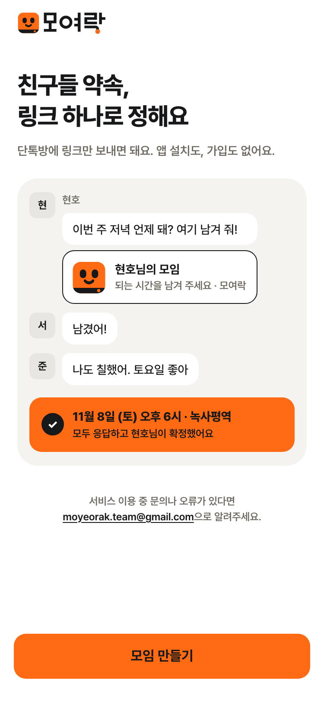
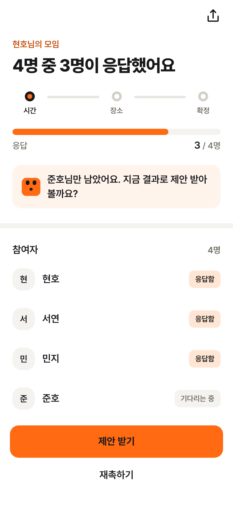
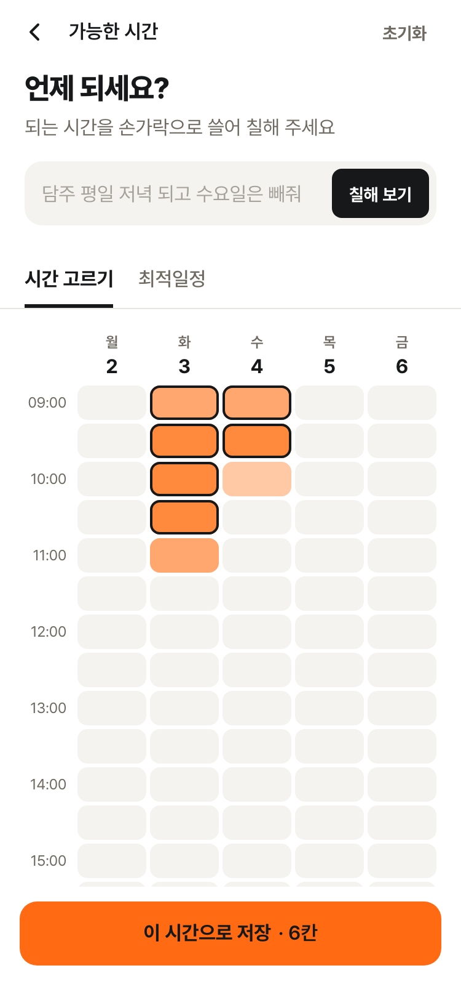
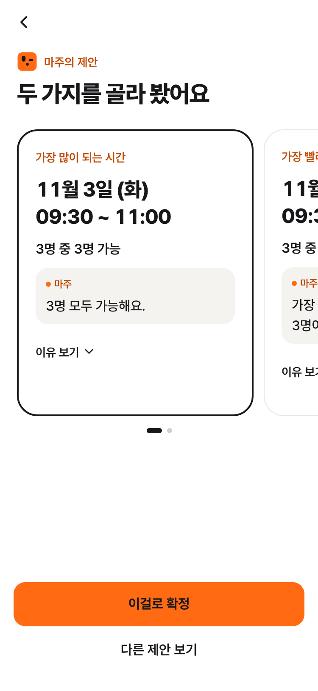
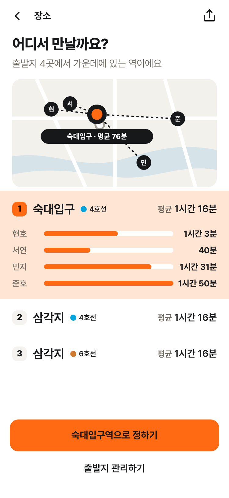
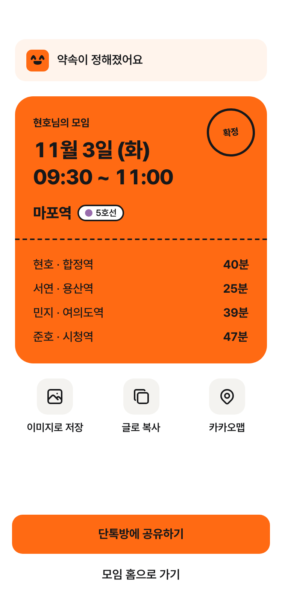
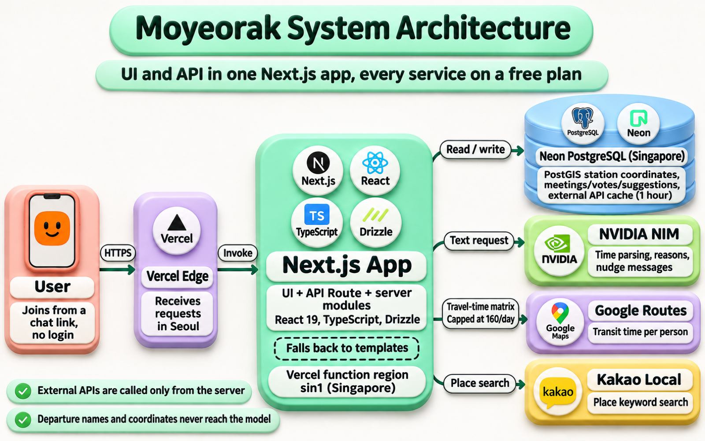
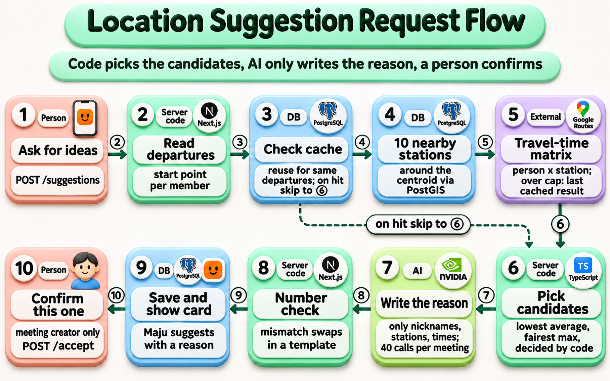

<div align="center">

<a href="https://moyeorak.hyunolike.dev">
  
</a>

### Everyone's time, one plan

[한국어](./README.md) | **English**

[](https://moyeorak.hyunolike.dev)
[-16161A?style=flat&logo=github&logoColor=white)](./docs/legacy/README.md)

<br/>

https://github.com/user-attachments/assets/f0a9be91-336c-49d0-a5df-f31b487eab14

<sub>From a group-chat link to a plan card, in a 21-second intro video</sub>

</div>

<br/>

## 🗓️ About

"So when and where are the four of us meeting?" Once that question shows up in a group chat, plans rarely settle on their own. Moyeorak (모여락, roughly "let's get together") collects everyone's available times and starting points through a single link and turns them into one plan the group can live with.

The first version stopped at listing overlapping times and nearby stations. The information was all there, but deciding was still left to the group chat. In the renewed Moyeorak, a character named **Maju** looks at the responses and suggests one or two times or places, and the person who created the meeting taps "Confirm this one" to finish. A person always makes the final call.

<div align="center">
  
</div>

<br/>

## 🖥️ Screens

| Start | Meeting home | Time vote | Maju's suggestion | Stations | Plan card |
| :---: | :---: | :---: | :---: | :---: | :---: |
|  |  |  |  |  |  |
| A group-chat scene and the create button | 3 of 4 members responded, with progress | A timetable filled by typing or by swiping | A time suggestion card with its reason | Midpoint stations on a map with each person's travel time | A confirmation card to paste into the chat |

<sub>The app UI is in Korean.</sub>

<br/>

## ✨ Features

| Feature | Description |
| --- | --- |
| Create a meeting | Choose time only, place only, or both, then share the link. Members join without logging in, and the same browser is recognized as the same person. |
| Type it in words | Write "I'm free Saturday from 2 to 6 pm" and AI fills in the timetable. Nothing is saved until the user checks it and taps save. |
| Maju's suggestions | Picks the time most people can make and the earliest alternative day, plus the station with the shortest average trip and the station where the person with the longest trip travels least, each with a reason. |
| Confirm | Only the meeting creator can confirm, either by choosing a suggestion or picking directly from the list. |
| Nudge messages | Drafts a message for people who haven't responded yet, ready to copy or hand to the share sheet. The service never sends it on its own. |
| Plan card | Saves a card with the date, station, each person's starting point and travel time, and a Kakao Map link, as text or an image. |

### Not trusting the AI

Code chooses the candidates and the model writes only one sentence explaining why. If a number in that sentence doesn't match the card's data, or it says "everyone can make it" while someone can't, the sentence is thrown away and replaced with a fixed template. When a model call fails or a meeting goes over its call limit (40), the same templates take over, so the feature keeps working. The model only receives nicknames, candidate times, station names, and travel times. Starting-point names and coordinates are never sent.

<br/>

## 🛠️ Tech Stack


<br/>

## 🏗️ Architecture

<p align="center">
  
</p>

- **One project:** The first version was split into a React SPA, Spring Boot, and EC2. The renewal keeps the UI and API in a single Next.js app, and AI calls run inside the same functions with no separate server.
- **Keep things in one region:** Neon has no Seoul region, so the database lives in Singapore and Vercel functions run in `sin1` to stay close to it. Requests enter at the Seoul edge and are handled by the Singapore function.
- **Midpoint:** PostGIS finds the 10 stations nearest the center of everyone's starting points, Google Routes returns each person's transit time, and the candidates are chosen from that. Results are cached in the database for an hour.
- **Preview deploys:** Every PR gets a Vercel preview that runs on Neon's `preview` branch with mocked external responses, so it doesn't eat into external API quotas.

### Location suggestion request flow

When someone taps "Maju's suggestion", the server handles it in the order below. Code picks the candidates, the model writes only the reason, and the meeting creator confirms.

<p align="center">
  
</p>

### Keeping the bill at zero

With only a few meetings created per month, every service runs on a free plan. Google Routes is the only one with a billing account attached, and three layers keep it under the free tier.

1. The app stops computing new results after 4,000 matrix elements per month (Seoul time) and serves cached results instead.
2. A Google Cloud quota rejects anything over 160 requests per day. Even all 31 days at the cap stay under the 5,000 free elements.
3. A budget alert is set at 1,000 KRW.

<br/>

## 📁 Repository Layout

```text
moyeorak
├── app/                 The Next.js app running in production
├── design/brand-v4/     Brand, the Maju character, screen mockups
├── docs/
│   ├── superpowers/     Design docs and implementation plans
│   ├── eval/            AI evaluation sets
│   ├── metrics/         Metric baselines
│   └── legacy/          First version overview
├── reference/           First version frontend and backend (submodules)
├── frontend/, backend/  Workspaces left empty before the renewal
└── docs/assets/         README screenshots, diagrams, and intro video
```

<br/>

## 🚀 Running Locally

You need Node 24, pnpm 10, and a PostGIS container.

```bash
git clone https://github.com/hyunolike/moyeorak.git
cd moyeorak/app
pnpm install
pnpm dev
```

Database setup, environment variables, tests, and deployment are covered in [app/README.md](./app/README.md) (Korean).

<br/>

## 🔗 More (Korean)

- [Renewal design](./docs/superpowers/specs/2026-10-30-moyeorak-renewal-design.md) and [free deployment design](./docs/superpowers/specs/2026-10-31-free-deployment-design.md)
- Implementation plans by phase: [Phase 0 foundation](./docs/superpowers/plans/2026-10-30-phase0-foundation.md), [Phase 1 face and entry](./docs/superpowers/plans/2026-10-30-phase1-face-and-entry.md), [Phase 2 decision](./docs/superpowers/plans/2026-10-31-phase2-decision.md), [Deployment](./docs/superpowers/plans/2026-10-31-free-deployment.md)
- [Brand v4](./design/brand-v4/BRAND.md)
- [First version overview](./docs/legacy/README.md): screens, tech stack, and architecture from the DND 14th cohort
