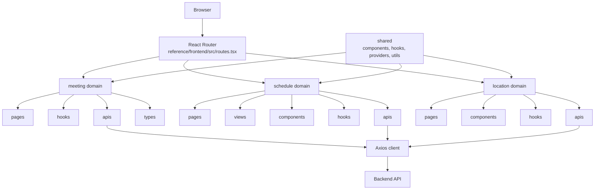
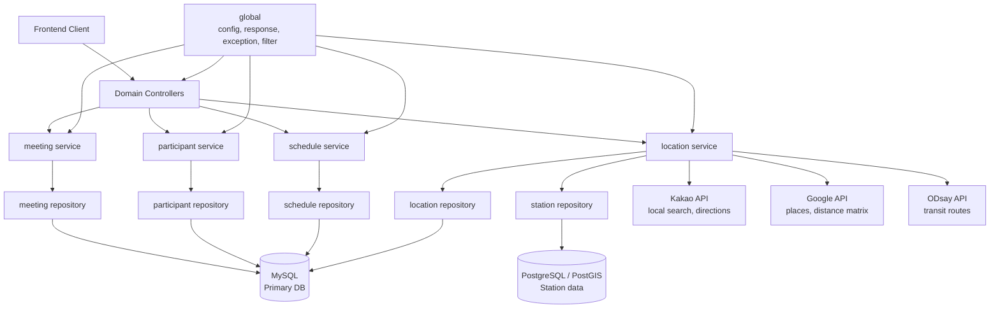

# 모여락 Moyeorak

> 모두의 시간과 위치를 모아, 가장 만나기 좋은 약속을 정하는 모임 조율 서비스

모여락은 여러 명이 함께 만날 때 필요한 일정 조율과 장소 조율을 한 흐름에서 처리합니다. 참여자는 가능한 시간을 투표하고 출발지를 등록할 수 있으며, 서비스는 함께 만나기 좋은 시간과 중간 지점, 주변 장소, 개인별 이동 경로를 제공합니다.

## 주요 기능

| 기능 | 설명 |
| --- | --- |
| 모임 생성 및 초대 | 일정 조율 또는 장소 조율 흐름으로 모임을 만들고 링크로 참여자를 초대합니다. |
| 일정 투표 | 참여자가 가능한 날짜와 시간을 입력하면 겹치는 시간대를 확인합니다. |
| 최적 시간 확인 | 투표 결과를 기반으로 함께 가능한 추천 시간대를 제공합니다. |
| 출발지 등록 | 각 참여자가 출발 위치를 등록하고 수정할 수 있습니다. |
| 중간 지점 추천 | 참여자 출발지를 기준으로 만나기 좋은 역과 중심 좌표를 추천합니다. |
| 주변 장소 탐색 | 추천 지점 근처의 카페, 음식점, 회의 공간 등을 탐색합니다. |
| 개인별 경로 확인 | 대중교통 또는 자동차 기준으로 참여자별 이동 경로를 확인합니다. |

[//]: # (## Team Members)

[//]: # ()
[//]: # (### Backend)

[//]: # ()
[//]: # (| 백도현 | 장현호 |)

[//]: # (|:---:|:---:|)

[//]: # (| [@BaekDoHyeon]&#40;https://github.com/BaekDoHyeon&#41; | [@hyunolike]&#40;https://github.com/hyunolike&#41; |)

## Tech Stack

### Frontend


### Backend


## Architecture

```text
moyeorak
├── frontend/            New main frontend workspace
├── backend/             New main backend workspace
└── reference/
    ├── frontend/        Previous team frontend Git submodule
    └── backend/         Previous team backend Git submodule
```

The previous team frontend is preserved under `reference/frontend/`. Its routes are organized by domain under `reference/frontend/src/domains`: `meeting`, `schedule`, and `location`. Shared UI, hooks, providers, and utilities live in `reference/frontend/src/shared`.

### Frontend Architecture



The previous team backend is preserved under `reference/backend/`. Its domains are organized under `reference/backend/src/main/java/com/dnd/moyeolak/domain`: `meeting`, `participant`, `schedule`, and `location`. The backend uses MySQL for primary domain data and PostgreSQL/PostGIS for station spatial data. External integrations include Kakao, Google, and ODsay clients for place search, directions, nearby places, and transit routes.

### Backend Architecture



## Getting Started

### Backend

```bash
cd reference/backend
cp .env.example .env
docker-compose up -d
./gradlew bootRun --args='--spring.profiles.active=local'
```

Run tests:

```bash
cd reference/backend
./gradlew test
```

### Frontend

```bash
cd reference/frontend
cp .env.example .env
pnpm install
pnpm dev
```

Build and check:

```bash
cd reference/frontend
pnpm check
pnpm build
```

## Links

- [New backend workspace](./backend/README.md)
- [New frontend workspace](./frontend/README.md)
- [Reference backend README](./reference/backend/README.md)
- [Reference frontend README](./reference/frontend/README.md)
- Swagger UI: `http://localhost:8080/swagger-ui.html`
- Storybook: `http://localhost:6006`
