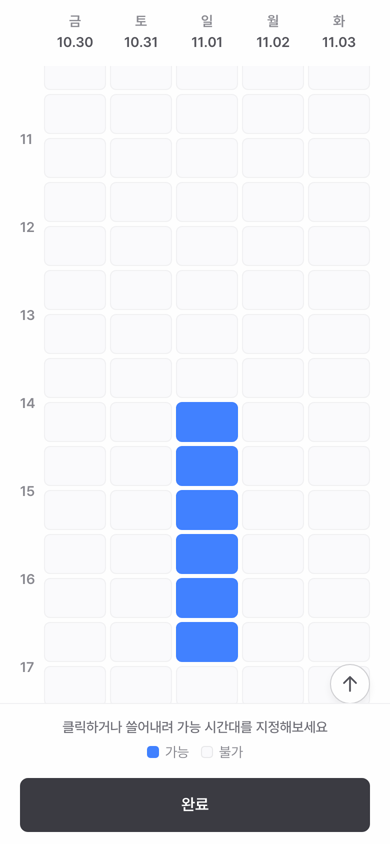
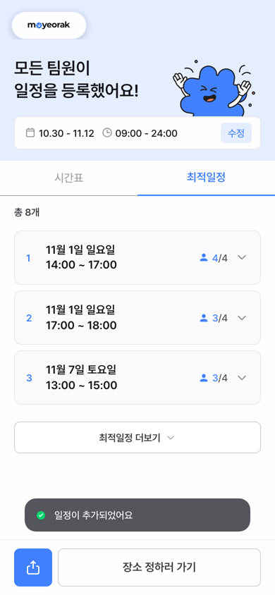
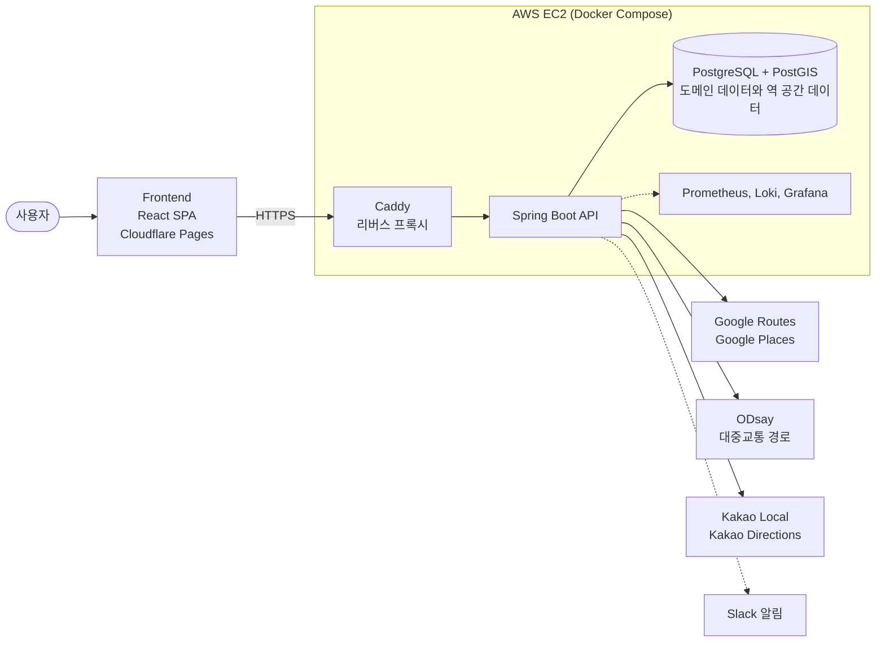

<div align="center">

<a href="https://moyeorak.site">
  
</a>

### 모임 일정과 장소를 쉽고 빠르게 정하는 모여락

[](https://moyeorak.site)
[](https://github.com/dnd-side-project/dnd-14th-8-backend)
[](https://github.com/dnd-side-project/dnd-14th-8-frontend)

<br/>

<a href="docs/assets/moyeorak-launch.mp4">
  
</a>

<sub>▶ 이미지를 누르면 23초짜리 소개 영상이 열립니다</sub>

</div>

<br/>

## 🗓️ 소개

"넷이 언제, 어디서 만나?" 단톡방에서 이 질문이 오가기 시작하면 약속은 쉽게 정해지지 않습니다. 모여락은 그 과정을 링크 하나로 끝내는 모임 조율 서비스입니다.

모임을 만든 사람이 링크를 공유하면, 참여자는 로그인 없이 들어와 가능한 시간을 시간표에 쓸어내려 표시합니다. 모두의 응답이 모이면 겹치는 시간대가 참여 인원 순으로 정렬되어 가장 많은 사람이 만날 수 있는 일정이 맨 위에 올라옵니다.

장소도 같은 방식으로 정합니다. 각자 출발지를 등록하면 출발지들의 지리적 중심 근처 지하철역 가운데 모두의 이동시간 합이 가장 짧은 역을 추천하고, 참여자별 대중교통과 자동차 경로, 역 주변 음식점과 카페까지 보여줍니다.

<br/>

## 🖥️ 서비스 화면

| 홈 | 링크로 초대 | 일정 투표 | 최적일정 | 출발지 등록 |
| :---: | :---: | :---: | :---: | :---: |
|  |  |  |  |  |
| 일정 조율과 중간지점 찾기 중 하나로 시작 | 링크를 받은 참여자는 바로 참여 | 가능한 시간을 쓸어내려 선택 | 모두 되는 시간이 1순위 | 출발지를 모아 중간지점 추천 |

<br/>

## ✨ 주요 기능

| 기능 | 설명 |
| --- | --- |
| 모임 생성과 초대 | 일정 조율 또는 중간지점 찾기로 모임을 만들고 링크로 참여자를 초대합니다. 회원가입은 필요 없습니다. |
| 일정 투표 | 참여자가 30분 단위 시간표에서 가능한 시간을 클릭하거나 쓸어내려 선택합니다. |
| 최적일정 | 투표 결과를 겹치는 인원 순으로 정렬하고, 시간대별로 참여 가능한 사람과 불가능한 사람을 보여줍니다. |
| 출발지 등록 | 참여자마다 출발지를 검색해 등록하고 수정할 수 있습니다. |
| 중간지점 추천 | 출발지 중심점 반경 5km 안의 지하철역 가운데 이동시간 합이 가장 짧은 역 3곳을 추천합니다. |
| 개인 경로와 주변 장소 | 추천 역까지의 대중교통과 자동차 경로, 역 주변 음식점과 카페 정보를 제공합니다. |

<br/>

## 🛠️ 기술 스택

### Frontend


### Backend


### Infra


<br/>

## 🏗️ 아키텍처



- **단일 DB:** 모임, 투표 같은 도메인 데이터와 지하철역 공간 데이터를 PostgreSQL + PostGIS 하나에 두고, 스키마는 Flyway 마이그레이션으로 관리합니다.
- **중간지점 추천:** 출발지 좌표의 지리적 중심을 구한 뒤 PostGIS `ST_DWithin`으로 반경 5km 안의 역을 찾습니다. Google Routes로 참여자별 이동시간 행렬을 계산해 합이 가장 작은 역 3곳을 고릅니다.
- **캐싱:** 같은 요청이 외부 API를 반복 호출하지 않도록 중간지점 추천 결과와 역 주변 장소를 Caffeine으로 캐시합니다.
- **배포:** 백엔드는 GitHub Actions에서 Docker 이미지를 ECR에 올린 뒤 EC2에서 Compose로 교체합니다. 인프라는 Terraform으로 관리합니다. 프론트엔드는 Cloudflare Pages에 배포되고 PR마다 미리보기 주소가 달립니다.

<br/>

## 📁 저장소 구조

```text
moyeorak
├── frontend/              새로 만들 프론트엔드 작업 공간
├── backend/               새로 만들 백엔드 작업 공간
├── reference/
│   ├── frontend/          기존 프론트엔드 (서브모듈, dnd-14th-8-frontend)
│   └── backend/           기존 백엔드 (서브모듈, dnd-14th-8-backend)
└── docs/assets/           README 이미지와 소개 영상
```

`reference/`의 두 서브모듈은 2026년 8월 말 커밋에 고정되어 있습니다. 백엔드는 `dev`, 프론트엔드는 `main` 브랜치 기준입니다.

<br/>

## 🚀 로컬 실행

```bash
git clone --recurse-submodules https://github.com/hyunolike/moyeorak.git
```

### Backend

Java 25와 Docker가 필요합니다.

```bash
cd reference/backend
cp .env.example .env    # KAKAO_API_KEY, GOOGLE_API_KEY, ODSAY_API_KEY 입력
./gradlew bootRun --args='--spring.profiles.active=local'
```

`bootRun`을 실행하면 spring-boot-docker-compose가 PostgreSQL과 Redis 컨테이너를 함께 띄우고, Flyway가 스키마와 역 데이터를 적용합니다. 외부 API 키가 없어도 서버와 일정 기능은 동작하지만 중간지점 추천, 경로, 주변 장소 기능은 키가 있어야 합니다.

```bash
./gradlew test                              # 테스트 (JaCoCo 커버리지 70% 기준)
docker-compose --profile monitoring up -d   # 모니터링 스택이 필요할 때만
```

- Swagger UI: http://localhost:8080/swagger-ui.html

### Frontend

Node 24 이상과 pnpm 10이 필요합니다.

```bash
cd reference/frontend
nvm use                 # .nvmrc 기준 Node 24
cp .env.example .env    # VITE_API_BASE_URL=http://localhost:8080, 지도 키 입력
pnpm install
pnpm dev
```

```bash
pnpm check        # Biome lint + format 검사
pnpm build        # 타입 검사 + 프로덕션 빌드
pnpm storybook    # 컴포넌트 카탈로그 (http://localhost:6006)
```

<br/>

## 🔗 더 보기

- [기존 백엔드 README](https://github.com/dnd-side-project/dnd-14th-8-backend#readme): ERD, API 명세, CI/CD 파이프라인
- [로컬 개발 환경 가이드](https://github.com/dnd-side-project/dnd-14th-8-backend/blob/dev/docs/local-dev-setup.md)
- [새 백엔드 작업 공간](./backend/README.md), [새 프론트엔드 작업 공간](./frontend/README.md)
