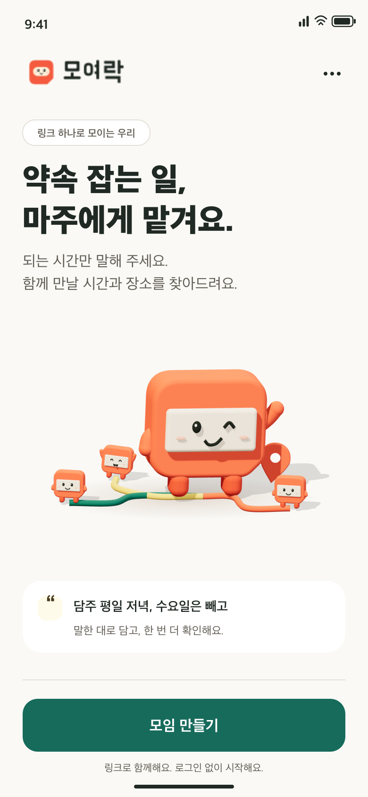
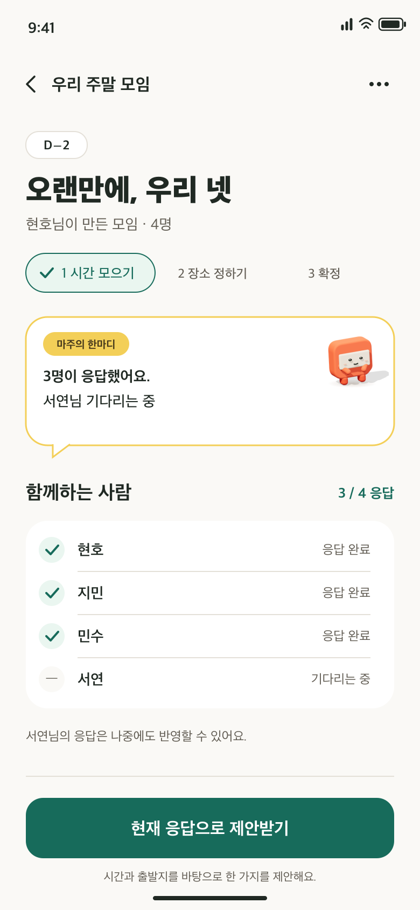
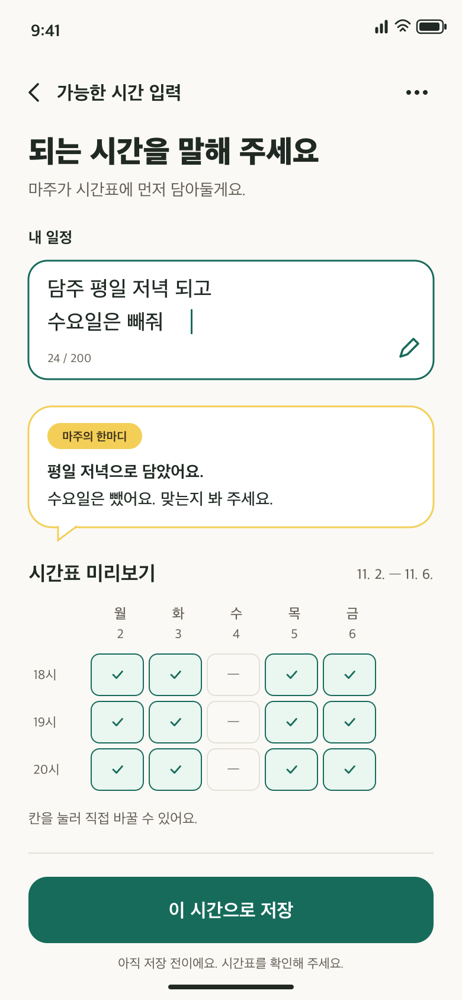
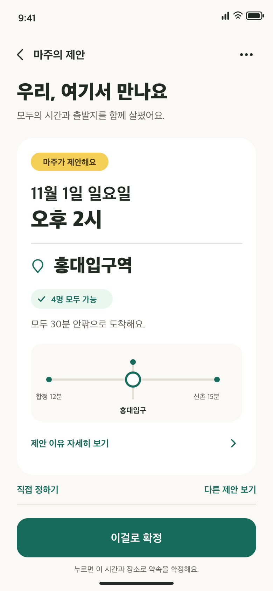
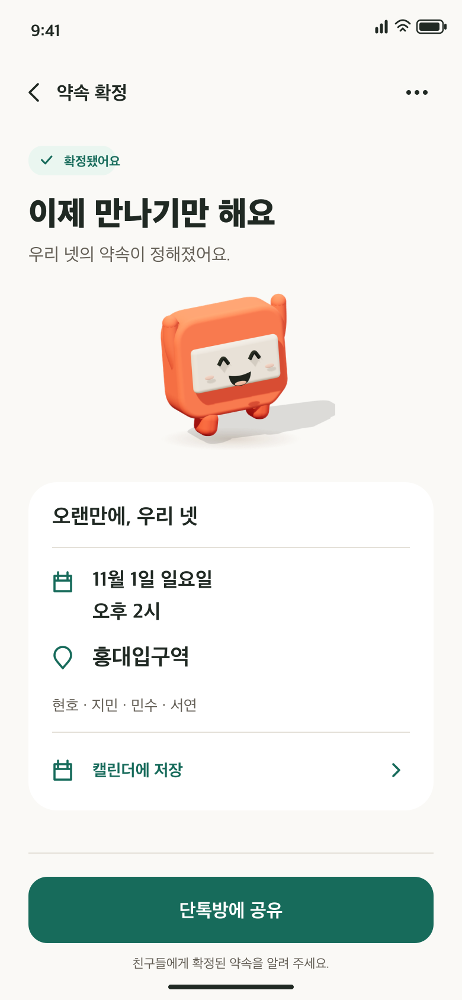
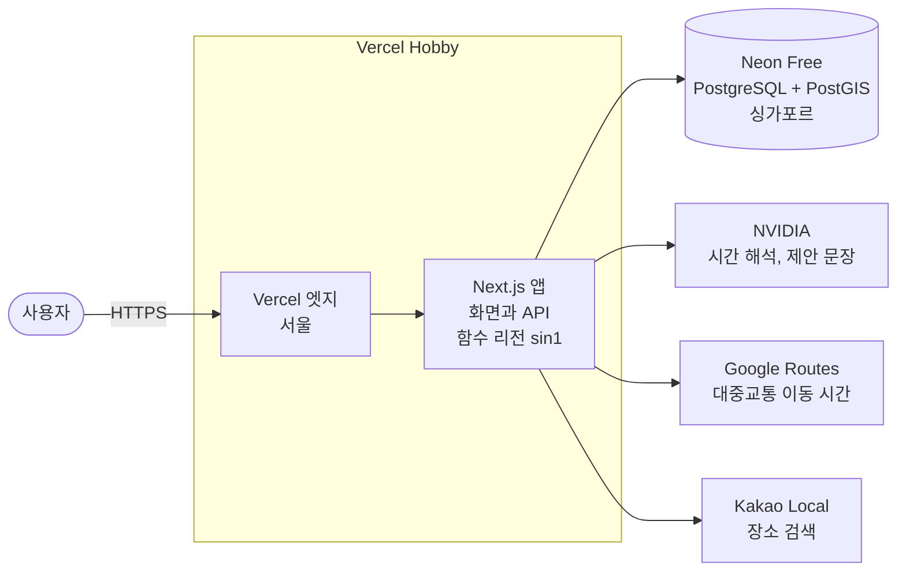

<div align="center">

<a href="https://moyeorak.hyunolike.dev">
  
</a>

### 서로의 시간을, 하나의 약속으로

[](https://moyeorak.hyunolike.dev)
[](./docs/legacy/README.md)

</div>

<br/>

## 🗓️ 소개

"넷이 언제, 어디서 만나?" 단톡방에서 이 질문이 오가기 시작하면 약속은 쉽게 정해지지 않습니다. 모여락은 링크 하나로 친구들의 가능한 시간과 출발지를 모으고, 받아들일 만한 약속 하나로 정리해 주는 조율 서비스입니다.

첫 버전은 겹치는 시간과 가까운 역을 목록으로 보여 주는 데서 멈췄습니다. 정보는 충분했지만 누가 마지막에 정하느냐는 여전히 단톡방의 몫이었습니다. 리뉴얼한 모여락에서는 캐릭터 **마주**가 응답을 보고 시간이나 장소를 한두 개 제안하고, 모임을 만든 사람이 "이걸로 확정"을 누르면 끝납니다. 마지막 결정은 언제나 사람이 합니다.

<div align="center">
  
</div>

<br/>

## 🖥️ 화면

| 시작 | 모임 홈 | 말로 입력하기 | 마주의 제안 | 확정 |
| :---: | :---: | :---: | :---: | :---: |
|  |  |  |  |  |
| 버튼 하나로 모임 만들기 | 진행 단계와 응답 현황 | "평일 저녁 다 돼"를 시간표에 칠하기 | 제안 한두 개와 이유 | 단톡방에 붙일 요약 카드 |

화면은 brand-v3 시안입니다.

<br/>

## ✨ 주요 기능

| 기능 | 설명 |
| --- | --- |
| 모임 만들기 | 시간만, 장소만, 둘 다 중에서 고르고 링크를 공유합니다. 참여자는 로그인 없이 들어오고, 같은 브라우저면 같은 사람으로 알아봅니다. |
| 말로 입력하기 | "토요일 오후 2시부터 6시까지 돼"처럼 쓰면 AI가 시간표에 칠해 줍니다. 저장은 사용자가 확인하고 눌러야 합니다. |
| 마주의 제안 | 가장 많이 되는 시간과 가장 빨리 모일 수 있는 다른 날, 평균 이동이 가장 짧은 역과 가장 오래 걸리는 사람이 가장 덜 걸리는 역을 골라 이유와 함께 보여 줍니다. |
| 확정 | 모임을 만든 사람만 확정할 수 있습니다. 제안을 고르거나 목록에서 직접 정합니다. |
| 재촉 메시지 | 아직 응답하지 않은 사람에게 보낼 메시지를 써 주고, 복사하거나 공유 시트로 넘깁니다. 서비스가 직접 보내지는 않습니다. |
| 요약 카드 | 날짜, 역, 사람별 출발지와 이동 시간, 카카오맵 링크를 담은 카드를 텍스트나 이미지로 저장합니다. |

### AI를 믿지 않는 장치

제안 후보는 코드가 고르고 모델은 이유 문장 하나만 씁니다. 문장 속 숫자가 카드의 데이터와 다르거나, 어려운 사람이 있는데 "모두 가능"이라고 쓰면 그 문장을 버리고 정해 둔 문장 틀로 바꿉니다. 모델 호출이 실패하거나 모임당 호출 한도(40회)를 넘어도 같은 문장 틀로 내려가서 기능은 멈추지 않습니다. 모델에는 닉네임, 후보 시간, 역 이름, 이동 시간만 보내고 출발지 이름과 좌표는 보내지 않습니다.

<br/>

## 🛠️ 기술 스택


<br/>

## 🏗️ 구조



- **한 프로젝트:** 첫 버전은 React SPA, Spring Boot, EC2로 나뉘어 있었습니다. 리뉴얼은 화면과 API를 Next.js 하나에 두고, AI 호출도 별도 서버 없이 같은 함수 안에서 합니다.
- **같은 지역에 두기:** Neon에는 서울 리전이 없어서 싱가포르를 쓰고, Vercel 함수도 `sin1`에 두어 DB와 가까이 붙였습니다. 요청은 서울 엣지로 들어와 싱가포르 함수가 처리합니다.
- **중간지점:** 출발지들의 중심 근처 역 10곳을 PostGIS로 찾고, Google Routes로 사람별 대중교통 시간을 구해 후보를 고릅니다. 결과는 DB 캐시에 한 시간 둡니다.
- **미리보기 배포:** PR마다 Vercel 미리보기가 생기고, Neon의 `preview` 브랜치와 모의 외부 응답으로 돌아서 외부 API 한도를 쓰지 않습니다.

### 비용을 0원으로 묶는 방법

모임이 한 달에 몇 개 만들어지는 규모라 모든 서비스를 무료 플랜으로 운영합니다. 결제 계정이 연결된 것은 Google Routes 하나이고, 무료 한도를 넘지 않게 세 겹으로 막습니다.

1. 앱이 서울 기준 한 달 행렬 항목 4,000건에서 새 계산을 멈추고 캐시된 결과를 씁니다.
2. Google Cloud 할당량으로 하루 160건을 넘는 요청을 거절합니다. 31일을 다 써도 무료 한도 5,000건 아래입니다.
3. 1,000원 예산 알림을 걸어 두었습니다.

<br/>

## 📁 저장소 구조

```text
moyeorak
├── app/                 지금 운영 중인 Next.js 앱
├── design/brand-v3/     브랜드, 캐릭터 마주, 화면 시안
├── docs/
│   ├── superpowers/     설계 문서와 구현 계획
│   ├── eval/            AI 평가 세트
│   ├── metrics/         지표 기준선
│   └── legacy/          첫 버전 소개
├── reference/           첫 버전 프론트엔드와 백엔드 (서브모듈)
├── frontend/, backend/  리뉴얼 전에 비워 둔 작업 공간
└── docs/assets/         첫 버전 화면과 소개 영상
```

<br/>

## 🚀 로컬 실행

Node 24, pnpm 10, PostGIS 컨테이너가 필요합니다.

```bash
git clone https://github.com/hyunolike/moyeorak.git
cd moyeorak/app
pnpm install
pnpm dev
```

DB 준비, 환경 변수, 테스트, 배포 절차는 [app/README.md](./app/README.md)에 있습니다.

<br/>

## 🔗 더 보기

- [리뉴얼 설계](./docs/superpowers/specs/2026-10-30-moyeorak-renewal-design.md)와 [무료 배포 설계](./docs/superpowers/specs/2026-10-31-free-deployment-design.md)
- 단계별 구현 계획: [0단계 기반](./docs/superpowers/plans/2026-10-30-phase0-foundation.md), [1단계 얼굴과 입구](./docs/superpowers/plans/2026-10-30-phase1-face-and-entry.md), [2단계 결정](./docs/superpowers/plans/2026-10-31-phase2-decision.md), [배포](./docs/superpowers/plans/2026-10-31-free-deployment.md)
- [브랜드 v3](./design/brand-v3/BRAND.md)
- [첫 버전 소개](./docs/legacy/README.md): DND 14기 때의 화면, 기술 스택, 아키텍처
